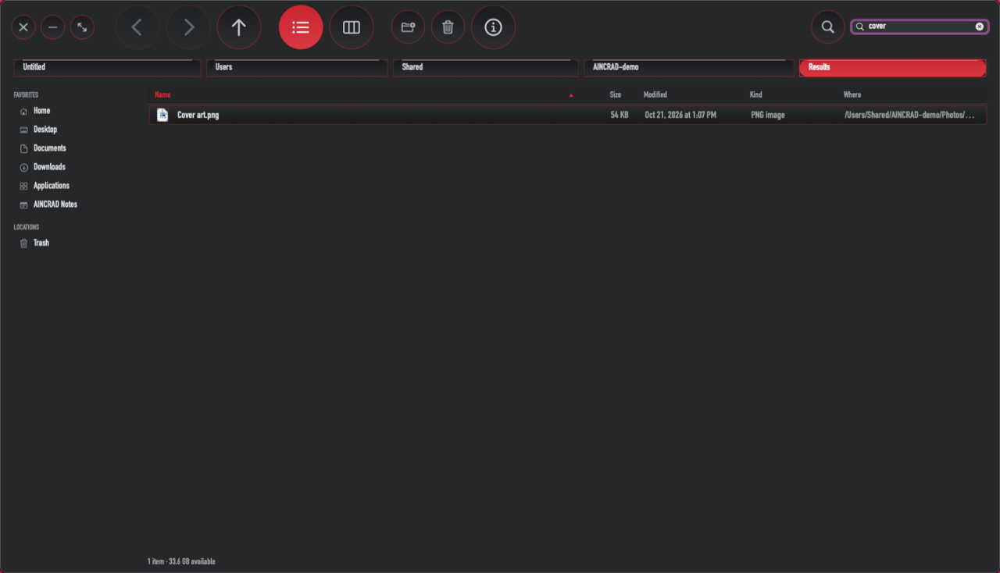
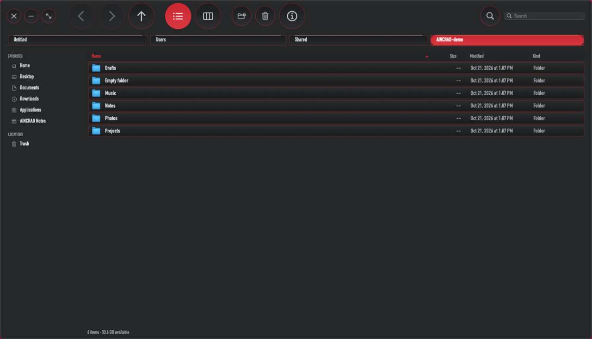
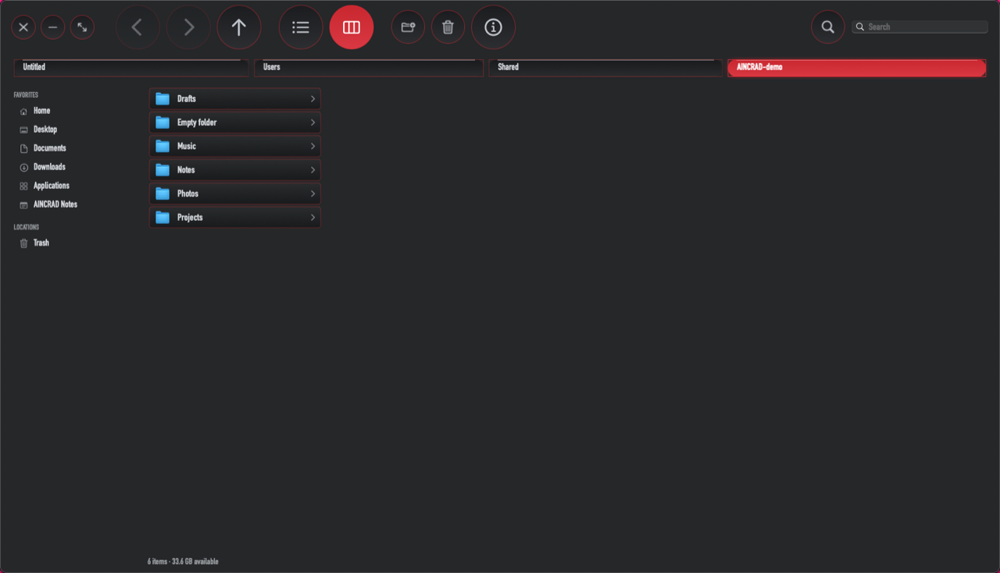
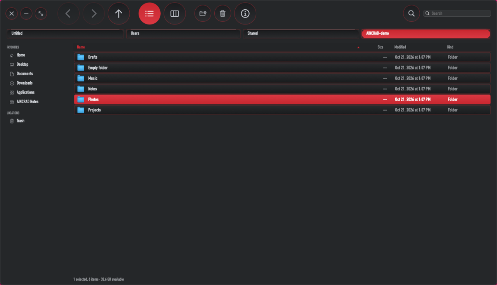
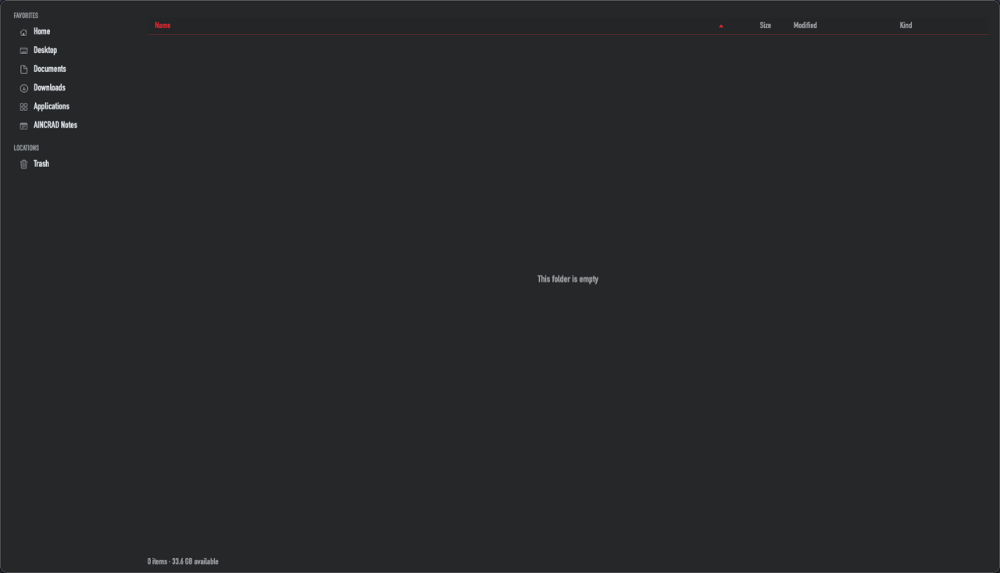
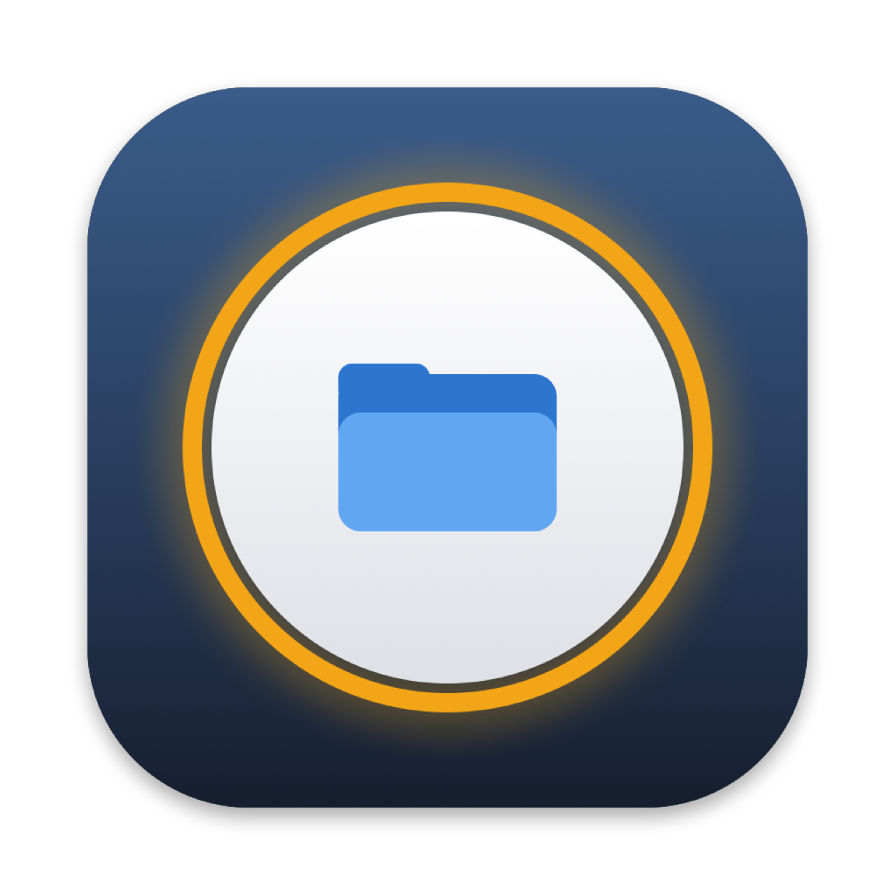
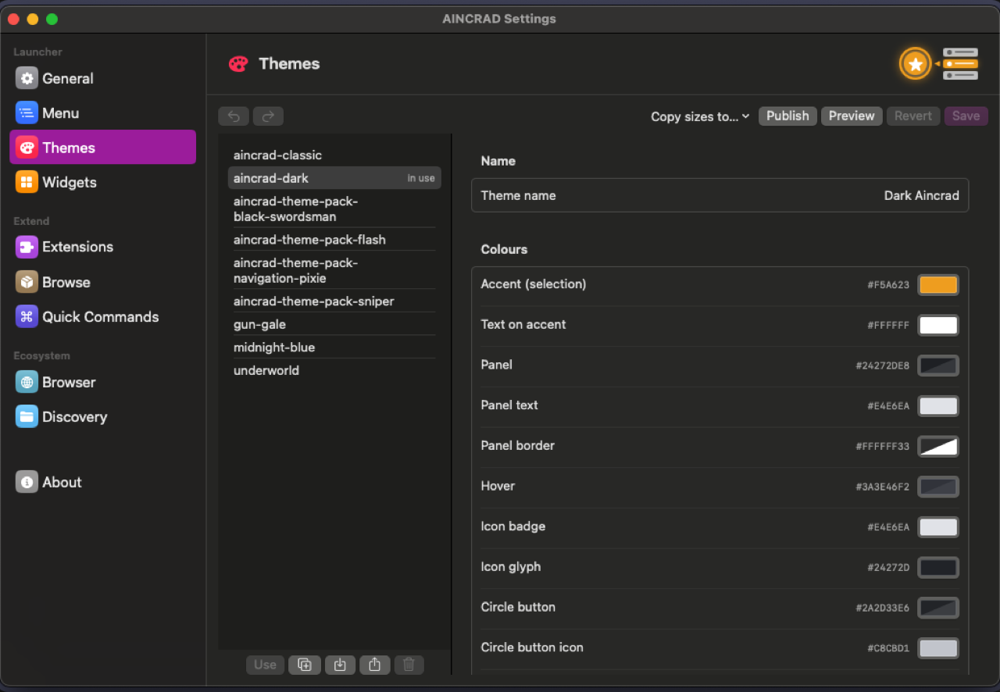
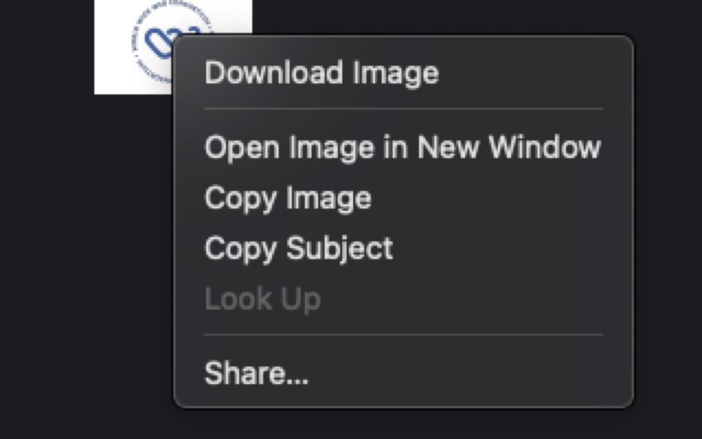

# AINCRAD

**A desktop that feels like one world.** AINCRAD brings the look and logic of Sword Art Online's menus to macOS: a system menu you summon with a gesture, themed apps that wear the same skin, and tools that talk to each other instead of living in separate windows.

This repository is the front door. It doesn't hold the code. It tells you what each piece is for and where to go next.

---

## The map

| Repo | What it is | Start here if you want to… |
| --- | --- | --- |
| [**AINCRAD**](https://github.com/djag1337/AINCRAD) | The core app: a SAO-style system menu, quick commands, settings, notes and app access | …understand the whole idea |
| **AINCRAD Prism** | Native theme workshop and assignment authority | …create or change the world's look |
| [**AINCRAD-catalog**](https://github.com/djag1337/AINCRAD-catalog) | Themes, skins and Scratch-style block extensions | …find another look |
| [**AINCRAD-Prism**](https://github.com/djag1337/AINCRAD-Prism) | The theme workshop: creates, edits and assigns every theme | …design a theme or pick the active one |
| [**AINCRAD-Browser**](https://github.com/djag1337/AINCRAD-Browser) | A native browser that wears the active AINCRAD theme | …browse the web inside the world |
| [**AINCRAD-Discovery**](https://github.com/djag1337/AINCRAD-Discovery) | A Finder replacement in the same style: list and column views, undo, search, a sidebar you can edit | …manage files inside the world |

## Where to begin

1. **Read [AINCRAD](https://github.com/djag1337/AINCRAD) first.** Everything else is built around its theme and its menus.
2. **Browse the [catalog](https://github.com/djag1337/AINCRAD-catalog)** if you want to see the range of themes and extensions.
3. **Try the [browser](https://github.com/djag1337/AINCRAD-Browser)** if you want the web on the same skin.
4. **Open [Discovery](https://github.com/djag1337/AINCRAD-Discovery)** if file management is your thing.

Each one installs on its own. Together they share a theme file, and they use the same settings where it makes sense.

## How the pieces talk

- **One authority, many windows.** AINCRAD Prism owns theme creation and assignment. AINCRAD, the browser and Discovery consume the shared files read-only and re-skin when Prism announces a change.
- **Shared links, not shared secrets.** The apps find each other through small link files and macOS notifications. No accounts, no servers, and no extra macOS permissions for the link itself.
- **Folders go where you expect.** Folder actions in the launcher open in Discovery when it's installed (you can turn that off in settings). Downloads and pages open in the browser when it's installed.
- **Your data stays on your Mac.** Nothing in the link sends your files or browsing history anywhere. Private browser windows are never shared.

---

## A quick look

*Search finds files anywhere below the folder you're in, and the Where column shows which folder each one lives in.*

*A Finder-style sidebar. Drop folders in to add favorites, drop files onto a folder to move them there.*

*Column view, for walking down a folder tree one level at a time.*

*Type a few letters and the list jumps to the first match. The status bar shows the free space on the disk.*

*Even empty folders have something to say.*

*Discovery's icon: the same glowing SAO button, holding a folder.*

*Themes keep their own colours. The "Copy sizes to…" menu carries a theme's sizes and spacing over to the others, and leaves the colours alone.*

*Right-click an image in the browser and choose Download Image. It lands in your Downloads folder like any other download.*

---

## Notes

This repository is a hub. It doesn't replace the individual repositories, and it won't keep up with every change in them. For implementation details, bugs and feature work, go to the repo that owns the part you care about.

The project is still moving. Expect rough edges, and expect the structure to shift as the ecosystem grows.
